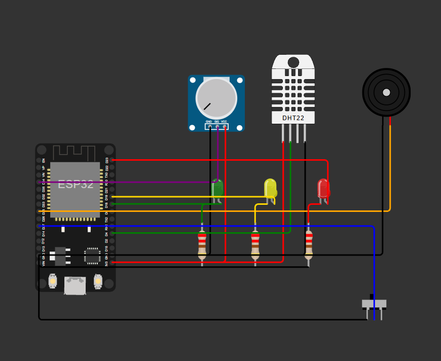

# Smoke Alert: Vigilância Autenticada contra Incêndio e Violação de Gabinete

> Projeto prático de IoT e Segurança da Informação desenvolvido na disciplina de Algoritmos e Estrutura de Dados (CESAR School).

## 👥 Integrantes da Equipe
- Felipe Mota (felipeeufrasiomota@gmail.com / felipinho09)
- Matheus Mazony (matheusmazony@gmail.com / matheusmazony-ops)
- João Henrique Bosshard (joao.bosshard@upe.br / matheusmazony-ops)
- Walisson Diogo (walisondiogo17@gmail.com / Waly16)
- Mateus Borba (mateus.borba@upe.br / joaobosshard-rgb)

---

## 📖 1. Contexto e História (O Problema)

Em ambientes como salas de servidores, depósitos e instalações industriais, um princípio de incêndio costuma ser precedido por sinais físicos mensuráveis: aumento de fumaça e de temperatura. Detectores tradicionais são isolados, apenas soam um alarme local e não informam ninguém à distância. Quando se conectam à rede, surge um segundo problema, o de **segurança da informação**: se o dispositivo aceita comandos pela rede sem autenticação, um atacante pode enviar comandos falsos, reaproveitar mensagens antigas (*replay*) ou se passar pelo próprio sensor.

Além disso, o equipamento instalado em campo também pode ser alvo de **violação física**: alguém abrir o gabinete para desativar o sensor ou adulterar o circuito.

O **Smoke Alert** resolve esses três pontos em um único dispositivo:

1. **Detecta** fumaça e temperatura elevada e classifica o risco em níveis (normal, atenção, alerta).
2. **Detecta e registra** a abertura indevida do gabinete.
3. **Aceita comandos remotos somente se autenticados** por HMAC-SHA256 com número de sequência, rejeitando mensagens forjadas ou repetidas, e **publica seu estado** via MQTT para monitoramento remoto.

---

## ⚙️ 2. Funcionalidades do Dispositivo

- [x] Monitoramento contínuo de fumaça (sensor de gás, simulado por potenciômetro no Wokwi) e de temperatura/umidade (DHT22).
- [x] Classificação automática em 5 estados por prioridade: `VIOLACAO` > `FALHA_SENSOR` > `ALERTA` > `ATENCAO` > `NORMAL`.
- [x] Sinalização local com LEDs (verde, amarelo e vermelho) e buzzer (tons diferentes para alerta e violação).
- [x] Detecção de abertura indevida do gabinete com chave/sensor de contato, com contador de violações e registro de tempo no monitor serial.
- [x] Autenticação de comandos MQTT com **HMAC-SHA256** (formato `SEQUENCIA|COMANDO|ASSINATURA`), com comparação em tempo constante.
- [x] Proteção contra **replay**: a última sequência aceita é salva na flash (`Preferences`) e sobrevive a reinicializações.
- [x] Respostas do dispositivo também **assinadas** com HMAC (formato `SEQUENCIA|RESPOSTA|HMAC`).
- [x] Publicação de estado (`status`, com *retain* e *Last Will* `OFFLINE`) e telemetria JSON (`sensores`) a cada 5 s.
- [x] Reconexão automática de Wi-Fi e MQTT sem bloquear o loop principal, com ID de cliente único por dispositivo.
- [x] Validações de entrada: limite de 200 bytes por mensagem, sequência numérica sem estouro de `uint32_t` e formato rígido.

---

## 🛠️ 3. Especificações Técnicas e Componentes

- **Microcontrolador:** ESP32 DevKit V1 (Wi-Fi + Bluetooth).
- **Sensores e Atuadores:**
  - Potenciômetro (simula a saída analógica de um sensor de fumaça/gás MQ-2).
  - Sensor de temperatura e umidade DHT22.
  - Chave deslizante (simula o sensor de abertura do gabinete, *tamper*).
  - 3 LEDs (verde, amarelo, vermelho) com resistores de 220 Ω.
  - Buzzer.
- **Ambiente de Desenvolvimento:** [Wokwi](https://wokwi.com/projects/481514710000344065) (simulador online de ESP32).
- **Framework:** Arduino (core ESP32) em C/C++.
- **Bibliotecas:**
  - `DHT sensor library` e `Adafruit Unified Sensor` (leitura do DHT22).
  - `PubSubClient` (cliente MQTT).
  - `WiFi`, `Preferences` e `mbedtls` (já incluídas no core do ESP32).
- **Comunicação:** MQTT sobre Wi-Fi, broker público `test.mosquitto.org:1883` (somente para testes).

### Limites de classificação (ajustáveis no código)

| Estado | Condição |
| :--- | :--- |
| `VIOLACAO` | Gabinete aberto (prioridade máxima) |
| `FALHA_SENSOR` | Leitura inválida (`NaN`) do DHT22 |
| `ALERTA` | Fumaça ≥ 2800 **ou** temperatura ≥ 50 °C |
| `ATENCAO` | Fumaça ≥ 1500 **ou** temperatura ≥ 35 °C |
| `NORMAL` | Nenhuma das condições acima |

---

## 🔌 4. Diagrama de Conexões (Pinout)

> Circuito completo no Wokwi: https://wokwi.com/projects/481514710000344065
>
> 

| Componente | Pino do Componente | Pino no ESP32 (GPIO) | Observações |
| Potenciômetro (sensor de fumaça) | SIG | GPIO 34 | Entrada analógica ADC1 (0 a 4095) |
| Potenciômetro (sensor de fumaça) | VCC / GND | 3V3 / GND | Alimentação |
| DHT22 | SDA | GPIO 4 | Leitura digital |
| DHT22 | VCC / GND | 3V3 / GND | Alimentação |
| Buzzer | Pino 2 (+) | GPIO 25 | Saída de tom (`tone`) |
| Buzzer | Pino 1 (-) | GND | |
| LED Verde | Anodo (A) | GPIO 18 | Estado `NORMAL`; cátodo em GND via 220 Ω |
| LED Amarelo | Anodo (A) | GPIO 19 | Estado `ATENCAO`; cátodo em GND via 220 Ω |
| LED Vermelho | Anodo (A) | GPIO 23 | `ALERTA`, `VIOLACAO` e `FALHA_SENSOR`; cátodo em GND via 220 Ω |
| Tamper | Pino 2 (comum) | GPIO 27 | `INPUT_PULLUP`: nível alto = gabinete aberto |
| Tamper | Pino 1 | GND | Nível baixo = gabinete fechado |

> **OBS** o GPIO 34 pertence ao ADC1, que continua funcionando com o Wi-Fi ligado. Os pinos do ADC2 não devem ser usados para leitura analógica enquanto o Wi-Fi estiver ativo.

---

## 🚀 5. Instruções de Compilação e Gravação

1. Clone o repositório:
   ```bash
   git clone https://github.com/felipinho09/SmokeAlert.git
   cd SmokeAlert
   ```
2. Abra o projeto no Wokwi (link acima) **ou** crie um novo projeto pelo template **ESP32** em [wokwi.com](https://wokwi.com) e copie os arquivos `sketch.ino`, `diagram.json` e `libraries.txt` do repositório.
3. Confira que o `libraries.txt` contém:
   ```
   DHT sensor library
   Adafruit Unified Sensor
   PubSubClient
   ```
4. Clique em **Start the simulation**. No monitor serial devem aparecer a conexão Wi-Fi (rede `Wokwi-GUEST`), a conexão MQTT e as leituras dos sensores a cada segundo.
5. *(Opcional, hardware real)* Em outra IDE (Arduino IDE ou PlatformIO), instale o core **ESP32 (Espressif)**, as três bibliotecas acima, selecione a placa **ESP32 Dev Module**, ajuste `ssid` e `password` no código e grave na placa.

### ▶️ Circuito funcionando

Demonstração do circuito em funcionamento:

<video src="Design_sem_nome_1.mp4" controls width="640"></video>

[Assistir ao vídeo](Design_sem_nome_1.mp4)

> **Problemas de compilação no Wokwi:** se aparecerem erros de link como `undefined reference to uartBegin` ou `app_main`, crie um projeto novo pelo template ESP32 e cole os arquivos novamente. Verifique também se não há arquivos `.ino`, `.cpp` ou `.h` duplicados no projeto.

---

---

## 📡 6. Protocolo MQTT e Testes

### Tópicos

| Tópico | Sentido | Conteúdo |
| `smoke-alert/equipe01/comandos` | entrada | Comandos autenticados |
| `smoke-alert/equipe01/respostas` | saída | Respostas assinadas |
| `smoke-alert/equipe01/status` | saída (*retain*) | Estado atual ou `OFFLINE` (Last Will) |
| `smoke-alert/equipe01/sensores` | saída | JSON a cada 5 s |

Exemplo de telemetria:

```json
{"estado":"NORMAL","fumaca":800,"temp":25.0,"umid":50.0,"violacoes":0}
```

### Autenticação dos comandos

- Formato da mensagem: `SEQUENCIA|COMANDO|ASSINATURA`
- Assinatura: HMAC-SHA256 (hexadecimal maiúsculo) de `SEQUENCIA:COMANDO`, com o comando em maiúsculas.
- A sequência deve ser **estritamente maior** que a última aceita; caso contrário a mensagem é rejeitada como *replay*.
- Comandos disponíveis: `PING`, `STATUS` e `INFO`.

Para gerar uma mensagem válida:

```c++
cd C:\Users\User\Documents\GitHub\SmokeAlert\cliente
g++ -std=c++17 -O2 -static -o smoke_cli.exe smoke_cli.cpp -lws2_32

Enviar comandos ao ESP32:

powershell
.\smoke_cli.exe PING
.\smoke_cli.exe STATUS
.\smoke_cli.exe INFO

Só gerar a mensagem assinada (sem enviar):

powershell
$seq = [int][double]::Parse((Get-Date -UFormat %s))
.\smoke_cli.exe --gerar $seq PING
.\smoke_cli.exe --gerar ($seq + 1) STATUS
.\smoke_cli.exe --gerar ($seq + 2) INFO
```

### Roteiro de testes

1. **Estados:** altere a temperatura no DHT22 e o potenciômetro, e confira a mudança de LEDs, buzzer e a linha `[ESTADO] -> ...` no serial.
2. **Violação:** mude a posição da chave deslizante e verifique o estado `VIOLACAO`, o buzzer em 2000 Hz e o contador de violações.
3. **Comando válido:** publique `msg(1, "PING")` no tópico de comandos e confira `1|PONG|<hmac>` em `respostas`.
4. **Replay:** publique a mesma mensagem novamente e verifique `REPLAY ATTACK DETECTADO!` no serial.
5. **Assinatura forjada:** altere um caractere da assinatura e verifique `ASSINATURA INVALIDA!`.

---

## ⚠️ 7. Limitações Conhecidas

- A chave HMAC está fixa no código e é **apenas de teste**. Em produção, ela deve ser gerada por dispositivo e armazenada de forma protegida (por exemplo, com *flash encryption*).
- O broker público e a porta 1883 não usam TLS: o HMAC garante **autenticidade e integridade**, mas **não confidencialidade** (o conteúdo trafega em texto claro). Para produção, use MQTT sobre TLS (porta 8883) com autenticação no broker.
- Os tópicos de telemetria (`status` e `sensores`) não são assinados, e qualquer cliente do broker público pode ler e publicar neles.
- O sensor de fumaça e o sensor de violação são simulados (potenciômetro e chave deslizante). Em hardware real, calibre os limites com um sensor MQ-2 e um contato magnético.
- No Wokwi, a memória flash costuma ser zerada a cada simulação, então a persistência da sequência só se comprova em hardware real.
